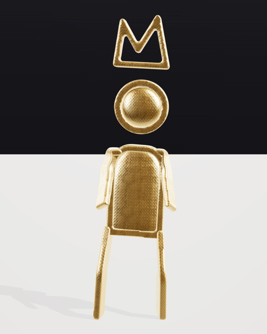

<h3 align="center">Maurrice McCann</h3>

Artist and founder of <a href="https://psychedluxuries.com"><b>Psyched Luxuries</b></a>. Seven years of daily practice, made wearable.

---

Every garment in the house carries an original piece from a seven-year daily archive. I make the art, and I build the machine that runs the house: the storefront, the archive, the content engine and a fleet of instruments that work while I sleep.

### The house, live

| | |
|---|---|
| [**psychedluxuries.com**](https://psychedluxuries.com) | The storefront and the congregation. Next.js on Cloudflare Workers, Square checkout, Printful fulfilment. |
| [**The System**](https://psychedluxuries.com/system) | The apparatus behind the practice, with the receipts public. |
| [**The Catalogue**](https://psychedluxuries.com/catalogue) | The archive, piece by piece. |
| [**THE FORGE**](https://forge.psychedluxuries.com) | The course: how a daily practice became a living operation. |

### Open to read

| Repo | What it is |
|---|---|
| [**pl-beta-games**](https://github.com/maurricemccann/pl-beta-games) | 33 standalone games and a hub, one self-contained HTML file each. p5.js and three.js. |
| [**pl-vj-studio**](https://github.com/maurricemccann/pl-vj-studio) | Third Eye, a desktop VJ instrument. Tauri. |
| [**pl-composer**](https://github.com/maurricemccann/pl-composer) | The scoring surface for the house's video renders. Next.js with a native Rust core. |
| [**focus-dots**](https://github.com/maurricemccann/focus-dots) · [**even-hub-teleprompter**](https://github.com/maurricemccann/even-hub-teleprompter) | PL FOCUS and PL PROMPTER, apps for Even Realities smart glasses. |

### Building now

- **GlyphGuy** in three.js: the house figure, rigged, dressed in real materials, shot as short films.
- **PL World**: a game set inside the house.

### The stack

`TypeScript` · `Next.js` · `Cloudflare Workers, D1, R2, Workers AI` · `three.js` · `Python` · `Rust` · `Blender`

---

<a href="https://psychedluxuries.com">psychedluxuries.com</a> · <a href="https://www.instagram.com/psychedluxuries">Instagram</a> · <a href="https://bsky.app/profile/psychedluxuries.com">Bluesky</a>

<i>Prepared for luxury. Watch this.</i>

